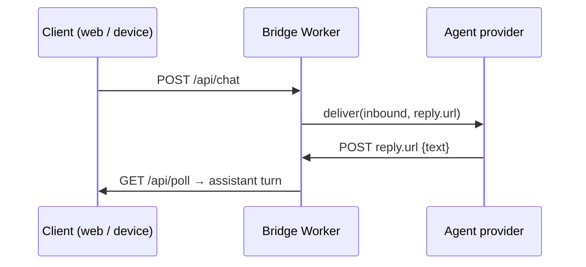

# Architecture

GrokChan connects a browser or M5Stack-class device to an upstream **agent** through a small Cloudflare Worker **bridge**.

English is the default. Chinese translation: [architecture.zh-CN.md](architecture.zh-CN.md).

## High-level flow

```text
┌─────────────┐     HTTPS              ┌──────────────────┐
│  Browser /  │ ─────────────────────▶ │  Bridge Worker   │
│  M5Stack    │ ◀───────────────────── │  (Cloudflare)    │
│  firmware   │     poll / reply text  │  + Durable Obj.  │
└─────────────┘                        └────────┬─────────┘
                                                │
                              agent.deliver()   │
                              + one-shot        │
                              reply.url         ▼
                                       ┌──────────────────┐
                                       │  Agent provider  │
                                       │  grokbot | muse… │
                                       └────────┬─────────┘
                                                │
                         POST /api/reply/<token>│
                                                ▼
                                       Bridge stores assistant turn
```



## Multi-agent design

HTTP routes and `ChatHub` are **provider-agnostic**. Upstream brains implement `AgentProvider` in `bridge/src/agents/`:

| Provider | Role |
| --- | --- |
| `grokbot` | POST webhook event (`grokbot-web.inbound.v1`) with `reply.url`; routine POSTs text back |
| `muse` | Stub today — reserved for Meta Muse / third-party Muse APIs later |

`AGENT_PROVIDER` selects the active adapter (`grokbot` default). Adding a new agent means a new module + registry case, not new chat routes.

## Components

| Piece | Role |
| --- | --- |
| `bridge/` | Deployable Worker + DO + chat UI + agent adapters |
| `firmware/` | ESP32 / M5Stack placeholder (mic / speaker / face later) |
| Grok Bot routine | Webhook-triggered; replies to `reply.url` |

## Secrets

Never commit secrets. Use `wrangler secret put` only:

- `GROK_WEBHOOK_URL`, `GROK_WEBHOOK_KEY`, `SITE_PASSCODE`

Set `PUBLIC_ORIGIN` and `AGENT_PROVIDER` as non-secret `[vars]`.

**Caveat:** some Cloudflare MCP/API tools redact secret values when writing them. Prefer interactive `wrangler secret put` so keys are not replaced by placeholders (symptom: webhook **401**).

See [bridge/README.md](../bridge/README.md).
