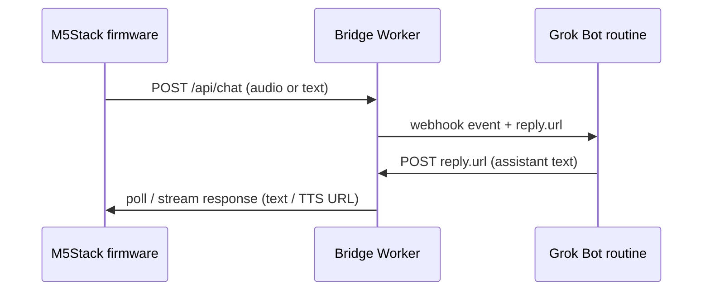

# Architecture

GrokChan connects an M5Stack-class device to [Grok Bot](https://grok.com) through a small Cloudflare Worker bridge and a webhook-triggered routine.

## High-level flow

```text
┌─────────────┐     Wi‑Fi / HTTPS      ┌──────────────────┐
│  M5Stack    │ ─────────────────────▶ │  Bridge Worker   │
│  firmware   │ ◀───────────────────── │  (Cloudflare)    │
│  (mic/spk)  │     TTS / reply text   │  + Durable Obj.  │
└─────────────┘                        └────────┬─────────┘
                                                │
                         POST webhook event     │
                         (incl. one-shot        │
                          reply.url)            ▼
                                       ┌──────────────────┐
                                       │  Grok Bot        │
                                       │  webhook routine │
                                       │  「device bridge」│
                                       └────────┬─────────┘
                                                │
                         POST /api/reply/<token>│
                                                ▼
                                       Bridge returns audio/text
                                       to the waiting device
```

## Mermaid (same idea)



## Components

| Piece | Role |
| --- | --- |
| `firmware/` | ESP32 / M5Stack sketch (Arduino or PlatformIO later): capture voice, play reply, simple face UI |
| `bridge/` | Cloudflare Worker pattern reused from web chat bridges: hold session state, call webhook, accept one-shot replies |
| Grok Bot routine | Webhook-triggered; generates the reply and POSTs it to `reply.url` |

## Secrets (never in git)

Configure via environment / `wrangler secret put` only:

- `GROK_WEBHOOK_URL` — routine webhook URL
- `GROK_WEBHOOK_KEY` — sender key
- Optional: device shared secret, `PUBLIC_ORIGIN` for reply URLs

See `bridge/README.md` for variable names. Do not commit passcodes or keys.
