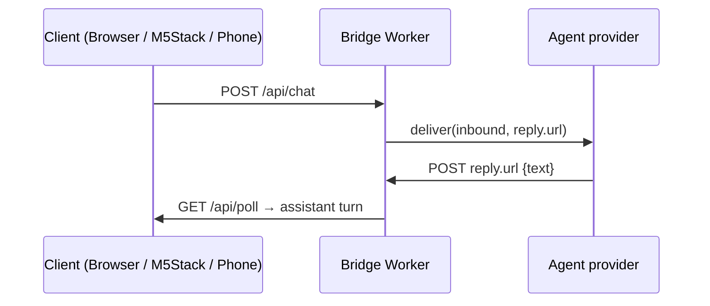

# Architecture

GrokChan connects a **Browser**, **M5Stack**-class device, or (roadmap) **Phone** client to an upstream **agent** through a small Cloudflare Worker **bridge**. Separately, **phone-use** lets the agent drive a real or cloud phone (tap / swipe / type / screenshot).

English is the default. Chinese translation: [architecture.zh-CN.md](architecture.zh-CN.md).

## High-level flow

```text
┌─────────────────┐     HTTPS              ┌──────────────────┐
│  Browser /      │ ─────────────────────▶ │  Bridge Worker   │
│  M5Stack /      │ ◀───────────────────── │  (Cloudflare)    │
│  Phone (client) │     poll / reply text  │  + Durable Obj.  │
└─────────────────┘                        └────────┬─────────┘
                                                    │
                                  agent.deliver()   │
                                  + one-shot        │
                                  reply.url         ▼
                                           ┌──────────────────┐
                                           │  Agent provider  │
                                           │  grokbot | muse… │
                                           └────────┬─────────┘
                                                    │
                             POST /api/reply/<token>│
                                                    ▼
                                           Bridge stores assistant turn

Phone-use (agent capability — not a new AGENT_PROVIDER):

  Agent (Grok Bot) ──MCP / tools──▶ cloud phone (e.g. Mobilerun)
                 └──ADB / screen mirror──▶ own Android (wireless debugging)
```



> **Bridge scope:** `bridge/` stays **chat ↔ agent**. Phone-use is primarily **tools on the agent** (Grok Bot MCP / device access). Do not invent a phone `AGENT_PROVIDER` for remote control. Optional later: treat the phone as a **client** of the bridge for voice/chat like M5Stack. See [phone-use.md](phone-use.md).

## Multi-agent design

HTTP routes and `ChatHub` are **provider-agnostic**. Upstream brains implement `AgentProvider` in `bridge/src/agents/`:

| Provider | Role |
| --- | --- |
| `grokbot` | POST webhook event (`grokbot-web.inbound.v1`) with `reply.url`; routine POSTs text back |
| `muse` | Stub today — reserved for Meta Muse / third-party Muse APIs later |

`AGENT_PROVIDER` selects the active adapter (`grokbot` default). Adding a new agent means a new module + registry case, not new chat routes.

## Components

| Piece | Role |
| --- | --- |
| `bridge/` | Deployable Worker + DO + chat UI + agent adapters |
| `firmware/` | ESP32 / M5Stack placeholder (mic / speaker / face later) |
| `phone-use/` | Roadmap placeholder for remote phone control docs/helpers |
| Grok Bot routine | Webhook-triggered; replies to `reply.url`; may also hold phone tools |

## Secrets

Never commit secrets. Use `wrangler secret put` only:

- `GROK_WEBHOOK_URL`, `GROK_WEBHOOK_KEY`, `SITE_PASSCODE`

Set `PUBLIC_ORIGIN` and `AGENT_PROVIDER` as non-secret `[vars]`.

**Caveat:** some Cloudflare MCP/API tools redact secret values when writing them. Prefer interactive `wrangler secret put` so keys are not replaced by placeholders (symptom: webhook **401**).

See [bridge/README.md](../bridge/README.md). Phone-use credentials (ADB keys, cloud-phone API tokens) likewise stay out of git — see [phone-use.md](phone-use.md).
