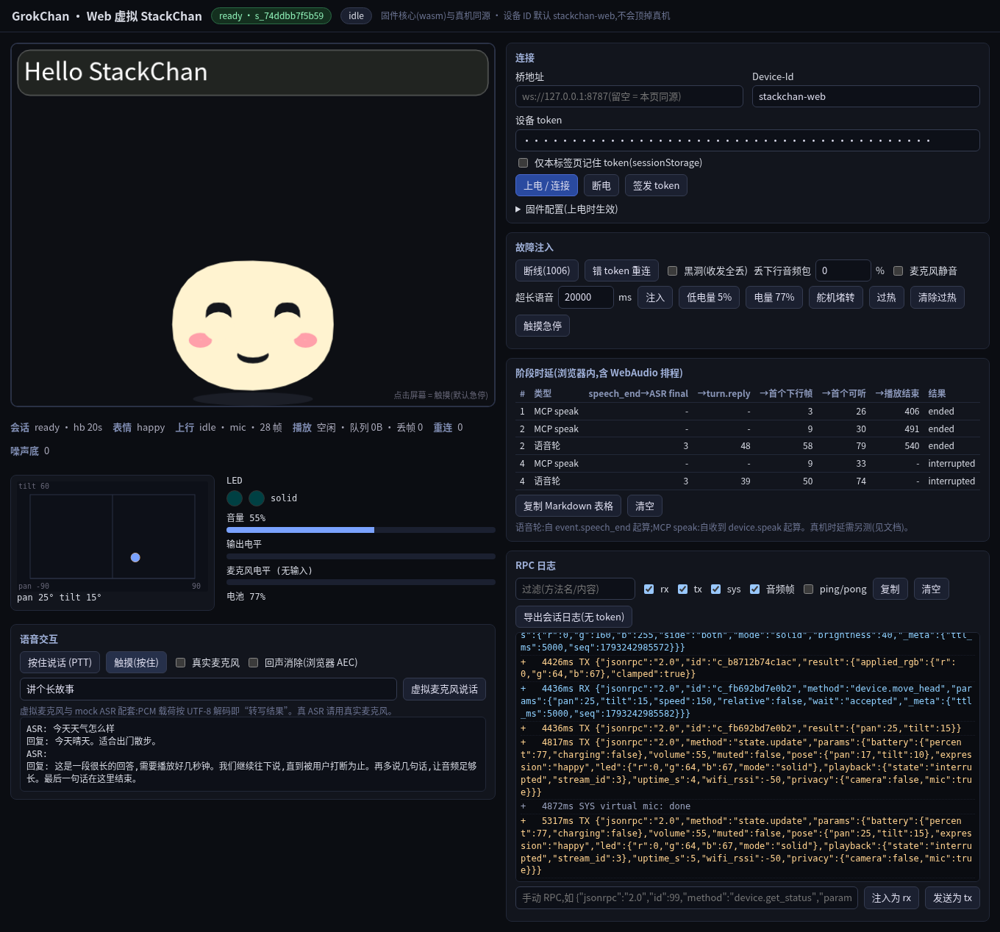

# Web 虚拟设备（StackChan 浏览器模拟器）

> 目的：不烧录硬件，就能用浏览器扮演一台 StackChan，对**真实或本地的 bridge** 跑端到端测试（`mediasession-rpc/1`）。
> 它是 [`e2e-hardware-checklist.zh-CN.md`](e2e-hardware-checklist.zh-CN.md) 的「预演」：能在网页里测通的先测通，剩下真正依赖硬件的才上真机。
> 截图：

## 1. 它是什么（以及为什么可信）

- **协议与逻辑不是 JS 重写的**：`firmware/lib/grokchan_core`（会话/RPC/幂等去重/回合状态机/VAD/上行/播放环形缓冲/脸部状态机……）被 zig 直接编译成 `wasm32-wasi`（`firmware/tools/webdevice/web/gc_core.wasm`，约 175 KB），
  浏览器 JS 只提供 HAL：WebSocket、WebAudio、画布、定时器。适配层是 `firmware/tools/webdevice/web_platform.cpp`。因此「握手帧、幂等、打断、VAD」跑的是固件同一份代码。
- **屏幕渲染同源**：`firmware/tools/preview/face_draw.js` 是唯一的 320x240 光栅化实现，`preview.html`（固件预览）和 Web 虚拟设备**共用**它，没有复制分叉。
- **身份独立**：默认 `device_id = stackchan-web`，不会挤掉真机 `stackchan-01`（同 id 再连会被 close 4000 顶掉，所以不要把两者设成同一个 id）。
- 静态纯 JS，无构建链（除重建 wasm），无第三方运行时依赖。

## 2. 怎么跑

### 2.1 本地（推荐）：wrangler dev + `/sim`（同源，免粘贴 token）

```bash
cd bridge
npm install
# .dev.vars（已被 gitignore；示例见 .dev.vars.example）：
#   STACKCHAN_ENABLED=true
#   SIM_UI_ENABLED=true
#   SITE_PASSCODE=<随便一个本地口令>
#   MCP_API_KEY=<随便一个本地 key>
#   TTS_PROVIDER=mock        # 或 mock-stream；想听真人声就配 elevenlabs（需要 key）
#   ASR_PROVIDER=mock        # 虚拟麦克风「文本说话」只在 mock ASR 下有意义
npx wrangler dev             # Node ≥ 22，默认 http://127.0.0.1:8787
```

1. 浏览器打开 `http://127.0.0.1:8787/`，用 `SITE_PASSCODE` 登录（写入 cookie）。
2. 打开 `http://127.0.0.1:8787/sim/`。
3. 点「签发 token」（同源、用登录态 `POST /api/devices/stackchan-web/token`，token 只放页面内存），再点「上电 / 连接」。
4. 浏览器会弹麦克风权限（只在勾选「真实麦克风」时才用）。**保持这个标签页在前台**（后台标签页会被浏览器降频，心跳/音频会抖）。

### 2.2 本地静态服务（连任意 bridge，包括已部署的）

```bash
node firmware/tools/webdevice/serve.mjs 8090      # 仅监听 127.0.0.1，无依赖
# 打开 http://127.0.0.1:8090/
```

页面里填「桥地址」（如 `ws://127.0.0.1:8787` 或 `wss://grokchan-bridge.<子域>.workers.dev`）、Device-Id（默认 `stackchan-web`）和 token。token 自己签发：

```bash
curl -s -X POST -H "X-Passcode: $SITE_PASSCODE" "$ORIGIN/api/devices/stackchan-web/token" | jq -r .token   # 只显示一次
```

token 勾选「仅本标签页记住」才会写 `sessionStorage`，**从不写 `localStorage`，也不会上传到任何地方**。

### 2.3 线上（可选，默认关闭）

`/sim` 在线上**默认 404**。要用：

```bash
# bridge/wrangler.toml 的 [vars] 取消注释（wrangler.toml 里已有注释行）：SIM_UI_ENABLED = "true"，同时 STACKCHAN_ENABLED = "true"
npx wrangler deploy
```

然后打开 `$ORIGIN/`，用 `SITE_PASSCODE` 登录，再访问 `$ORIGIN/sim/`。不用时把它改回 `false`/删掉再部署。
`/sim` 受 `SITE_PASSCODE` 登录态保护，并带严格 CSP（见 §4）。线上务必走 https/wss。

### 2.4 重新编译 wasm（只在改了 `lib/grokchan_core` 或 `web_platform.cpp` 时）

```bash
pip install ziglang        # 或自行装 zig；PEP 668 环境用 venv
ARDUINOJSON_DIR=/path/to/ArduinoJson/src ZIG="python -m ziglang" firmware/tools/webdevice/build_wasm.sh
cd bridge && npm run gen:sim   # 把 web/ 静态文件重新打包进 src/sim/assets.gen.ts（/sim 用）
```

`web/gc_core.sources.sha256` 记录 wasm 对应的源码指纹；`bridge/test/sim.unit.test.ts` 会校验「wasm 与源码同步」「assets.gen.ts 与 web/ 同步」，忘了重编/重打包会直接红。

## 3. 浏览器怎么鉴权（方案与理由）

浏览器的 `WebSocket` **不能设置 `Authorization` 头**，所以不能走固件用的 Bearer。可选：query 参数、首帧、子协议。选了**子协议**：

```js
new WebSocket(url, ["mediasession-rpc.v1", "gc-auth.<token>"])
```

- 服务端只回显 `mediasession-rpc.v1`（`Sec-WebSocket-Protocol` 里**不回显**带 token 的那一项），并在转发给 Durable Object 之前**抹掉**含 token 的头，后面的代码拿不到明文。
- token 不在 URL 里（query 会进访问日志、Referer、浏览器历史），也不是首帧（首帧要先放行未认证连接，等于削弱鉴权）。
- **鉴权没有被削弱**：
  - 错 token 仍然 **close 4003**；拒绝时也完成握手（回显 `mediasession-rpc.v1`），所以浏览器看到的是 4003 而不是笼统的 1006。
  - `Authorization: Bearer` 行为不变，且优先于子协议。
  - 失败请求与原有的 IP 限速（10 次/分钟）共用同一个计数。
  - token 比较仍是原来的恒时比较，没有新增放行路径。
- 代码：`bridge/src/auth.ts`（`parseWsAuth` / `scrubWsAuthHeaders` / `rejectWebSocket`）、`bridge/src/index.ts` 的 `/ws/device`；
  测试：`bridge/test/ws-subprotocol.e2e.test.ts`（对真实 `wrangler dev`：子协议通过、错 token 4003、Bearer 不变、限速共享、token 不在回显头里）。

## 4. `/sim` 的安全边界

- 路由门禁：`SIM_UI_ENABLED=true` **且** `STACKCHAN_ENABLED=true` **且**已用 `SITE_PASSCODE` 登录；否则 404/401。
- CSP：`default-src 'none'; script-src 'self' 'wasm-unsafe-eval'; style-src 'self'; img-src 'self' data:; connect-src 'self' ws(s)://<本站>; worker-src 'self'; media-src 'none'; base-uri 'none'; form-action 'none'; frame-ancestors 'none'`。
  没有 `unsafe-inline`/`unsafe-eval`（只有 wasm 的 `wasm-unsafe-eval`），页面只用外链脚本和样式。另有 `x-frame-options: DENY`、`cache-control: no-store`、`permissions-policy: microphone=(self)`。
- 导出的会话日志里 token 一律替换成 `[redacted]`（测试断言导出文本里没有 token）。

## 5. 功能一览

| 区域 | 内容 |
|---|---|
| 屏幕 | 320x240 脸（4 个回合状态 idle/listening/thinking/speaking，11 个表情，字幕气泡），与固件同一份光栅化 |
| 舵机/灯/音量 | pan/tilt 示意图（限位、超限被拒、`-32002` 等），2 颗 LED 颜色/模式，音量、静音，输出/麦克风电平 |
| 协议 | `session.hello`（与固件一致）、心跳 ping/pong、指数退避重连、幂等去重、全部 `device.*` 方法、下行 0x01 解码 + WebAudio 播放、上行麦克风 → 0x02 帧、PTT、VAD、turn/asr/reply/stream.error、与 `gc_voice` 一致的打断 |
| 调试 | RPC 日志（rx/tx/sys，过滤，复制）、回合状态、分阶段耗时表、故障注入、手动 RPC 输入框、导出会话日志（无 token） |
| 故障注入 | 断开/黑洞（收发全丢）、丢下行音频包 %、麦克风静音、超长语音、低电量、过热/堵转、急停、错误 token |
| 虚拟麦克风 | 「文本说话」把文本的 UTF-8 字节当作 16 kHz PCM 送进**真实的 VAD 与上行逻辑**（仅 `ASR_PROVIDER=mock`）；或勾「真实麦克风」用 AudioWorklet 采集（可选浏览器 AEC） |

分阶段耗时表（可「复制 Markdown 表格」）：`speech_end → 首个 ASR final`、`→ turn.reply`、`→ 首个下行音频帧`、`→ 播放结束`，以及 `speak` 的「命令 → 首帧 / 播放结束」。口径对应 checklist §3.14。

## 6. 自动化冒烟测试

`bridge/test/webdevice.e2e.test.ts`：真实 Chrome（Playwright，`playwright-core` + 本机 Chrome）连真实 `wrangler dev`（mock ASR/TTS + mock webhook），共 11 项：
CSP/加载无违规、签发 token → 上电 → hello → ready（脸有渲染、以 `stackchan-web` 注册）、MCP 各 `device.*` 方法（pose/限位/表情/字幕/LED/音量）、MCP `speak` → 下行帧 → 播放 → 耗时行、
语音回合（虚拟麦克风 → 真实 VAD → speech_start/end + 0x02 → ASR → webhook → reply → TTS → 播放）、触摸打断（`playback.state interrupted`，bridge 中止流）、
故障注入（超长语句由固件按 hello 的 `limits` 自行截断、低电量、过热拒绝运动、急停）、手动 RPC 与导出无 token、断线退避重连、错误 token → 4003 → 连续 3 次自动断电 → 恢复，另有截图。

```bash
cd bridge
npm run typecheck && npm test                 # 全量（含本测试；没有 Chrome 时本测试自动 skip）
npx vitest run test/webdevice.e2e.test.ts     # 只跑浏览器冒烟（约 40–60 s；CHROME_PATH 可指定浏览器）
```

### 6.1 本次实测耗时（本机 wrangler dev + mock ASR/TTS，Chrome headless，单位 ms）

| 类型 | speech_end→ASR final | →turn.reply | →首个下行帧 | →首个可听 | →播放结束 | 结果 |
|---|---|---|---|---|---|---|
| MCP speak | - | - | 3 | 26 | 406 | ended |
| MCP speak | - | - | 9 | 30 | 491 | ended |
| 语音轮 | 3 | 48 | 58 | 79 | 540 | ended |
| MCP speak | - | - | 9 | 33 | - | interrupted |
| 语音轮 | 3 | 39 | 50 | 74 | - | interrupted |

（语音轮从 `event.speech_end` 起算，`turn.reply` 由测试脚本手动回调 mock webhook；MCP speak 从收到 `device.speak` 起算。这些数字只证明计时链路通，**不代表真机延迟**。）

## 7. 与真机的差异（请带着这些预期用）

- **能覆盖**：协议/握手/鉴权/重连、幂等、回合状态机、VAD 起止与上行帧、打断、下行解码与播放排队/underrun 逻辑、MCP 全部设备命令的参数校验与限位/拒绝、屏幕四状态与 11 表情的**逻辑**与外观（同源光栅化）、字幕、LED/音量状态、桥端 ASR/Grok/TTS 全链路。
- **不能覆盖**：I2S 麦/扬声器与真实回声（浏览器 AEC ≠ 板载回声）、舵机真实运动/堵转/电流、LCD 实际帧率与配色、PSRAM/内存余量、Wi‑Fi 2.4 GHz 与 RSSI、真实网络抖动、电量/温度传感器、`WebSocketsClient` 阻塞行为、断电重启流程；固件里「待实机确认」的项目都得上真机。
- **虚拟麦克风只配 mock ASR**：真实 ASR（workers-ai/elevenlabs）需要真语音，用「真实麦克风」。
- **延迟不具代表性**：mock TTS 的音频只有 ~100 ms，mock ASR 几乎零延迟，耗时表里的数字只用来验证「计时口径是通的」，**不能**当作真机体验延迟；要测真实延迟请接真实 ASR/TTS/Grok Bot，并仍以真机为准。
- 音频需要用户手势才能启动 `AudioContext`：点任一按钮后才会出声；后台标签页会被浏览器降频。
- 「连续 3 次 4003 自动断电」是模拟器为避免触发桥端 10 次/分钟限流加的便利，真机固件不会这样做（可在页面里关掉）。

## 8. 风险与注意

1. 子协议里带 token：TLS 下不会被网络路径看到，但 Cloudflare 的请求日志/可观测性可能记录 `Sec-WebSocket-Protocol` 头；服务端不回显且不转发，但**别把这个 token 当高权限密钥**——它只能连 `stackchan-web`，随时可 `DELETE /api/devices/stackchan-web/token` 吊销。
2. 错 token 反复重连会撞到 IP 限速（10 次/分钟）并连累同 IP 的其他请求，所以默认 3 次后自动断电。
3. 线上务必走 https/wss；`SIM_UI_ENABLED` 用完关掉。
4. 日志导出会抹掉 token，但消息正文（对话内容）仍在里面，别随手贴到公开地方。
5. wasm 是二进制产物，修改 `lib/grokchan_core` 后必须重编并 `npm run gen:sim`，否则单测会红（这是有意的防漂移）。
